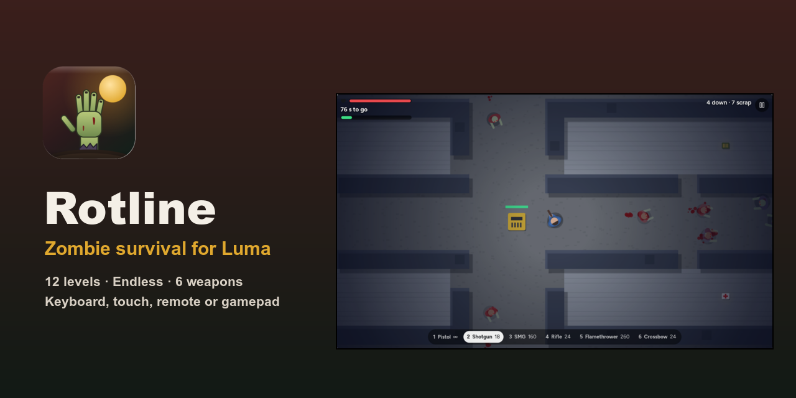
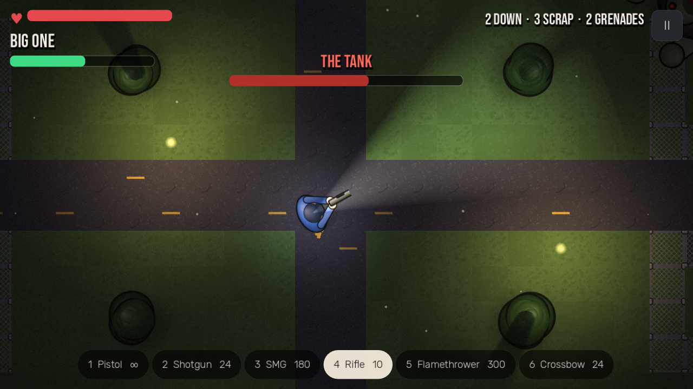
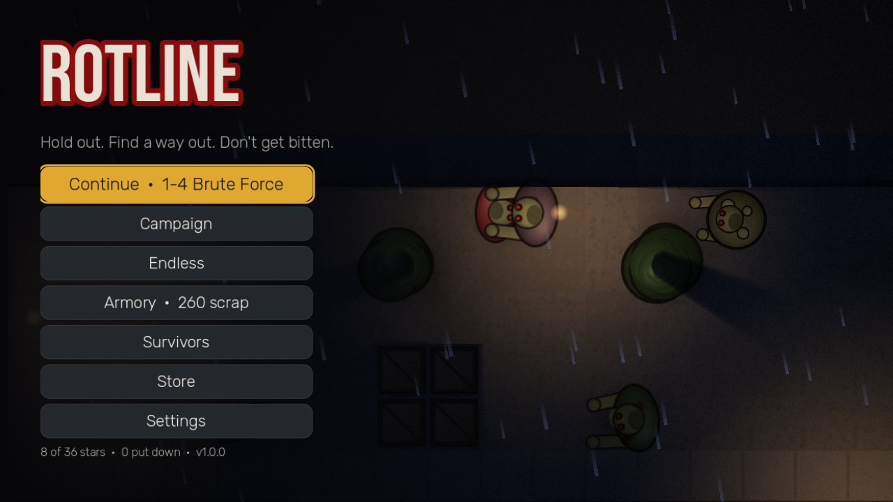
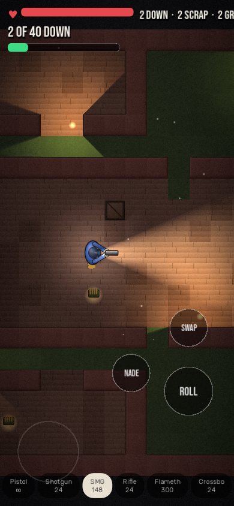

<p align="center">
  
</p>

<p align="center">
  <a href="https://github.com/chartmann1590/rotline/actions/workflows/tests.yml"></a>
  <a href="LICENSE"></a>
  <a href="https://godotengine.org"></a>
  <a href="https://simplyluma.com"></a>
  
</p>

# Rotline

**Top-down zombie survival, made with [Godot 4](https://godotengine.org) for [Luma](https://simplyluma.com).**

The power's out, the neighbours aren't themselves, and the only way out is through them, across three chapters:

- Hold out until morning.
- Find fuel for the car.
- Keep a generator running.
- Clear the subway.
- Bring down the Tank.

Then see how long you last in Endless.

It's dark, and your torch is the brightest thing on the street. Its beam casts real shadows off every wall, car and
crate, so something can always be standing just behind the light.

<table>
  <tr>
    <td width="50%"></td>
    <td width="50%"></td>
  </tr>
  <tr>
    <td width="50%"></td>
    <td width="50%"></td>
  </tr>
  <tr>
    <td width="50%"></td>
    <td width="50%"></td>
  </tr>
</table>

### On every Luma device

<table>
  <tr>
    <th>TV, with a remote or a gamepad</th><th>Phone, with two thumbs</th>
  </tr>
  <tr>
    <td width="70%"></td>
    <td width="30%" align="center"></td>
  </tr>
</table>

## The game

- **Twelve levels in three chapters,** each with its own weather.
  - *Maple Street*: the suburbs at dusk, with ash in the air.
  - *Downtown*: night, rain and lightning, gridlock, a hospital, the subway and a rooftop.
  - *The Harbor*: fog over the water, warehouses, a lighthouse and the last ferry.
- **Five kinds of goal.** Survive the clock, escape (find every fuel can, then reach the way out), defend the
  generator, clear a horde, or bring down the Tank. Hordes rush in partway through the timed levels.
- **Six kinds of dead.**
  - Walkers shuffle and runners don't.
  - Brutes soak up bullets.
  - Spitters keep their distance and spit acid.
  - Bloaters burst and take their friends with them.
  - The Tank roars, winds up and charges, so get out of the way.
- **Six weapons.**
  - The pistol never runs dry.
  - The shotgun knocks them back.
  - The SMG chews through a crowd.
  - The rifle goes through four in a line.
  - The Arsenal pack adds the flamethrower and the crossbow.
- **Moves.** A **dodge roll** gets you out of anything for a moment. **Grenades** come with a fuse and a big bang,
  and you find more as you go.
- **Streaks.** Put down five, ten or twenty in a row for bonus scrap.
- **Endless.** No way out and no end. A new wave arrives every 45 seconds, they get tougher, and a Tank turns up
  every two minutes. Your longest run is kept.
- **The Armory.** Spend scrap on toughness, firepower, fire rate, speed and ammo. You earn scrap from every one you
  put down and for finishing levels, and you keep it even when you lose. You can give it all back and spend it
  differently.
- **Stars.** Three for finishing with most of your health, two for half, one for getting out at all.
- **Story mode** halves the damage you take. You can turn off screen shake and the lightning flashes.
- **Five survivors** to play as. It's only looks: nobody is stronger.
- No account, no ads, no tracking ([privacy policy](PRIVACY.md)). Playing works offline.

## How it looks and sounds

Everything is made by Rotline itself. There are no stock assets.

- **Art.** The survivors and the dead (with walk cycles), tiles for three places, cars, trees, crates and shipping
  containers, pickups, blood, smoke and fire are all painted in code by [`tools/make_art.py`](tools/make_art.py).
- **Light.** Godot's 2D lighting does the rest:
  - your torch, street lamps that sometimes flicker, muzzle flashes, explosions and the flamethrower are real lights;
  - walls, cars and crates cast shadows from all of them;
  - a canvas modulate sets each chapter's night.
- **Shaders** move light across the water, drift fog over the harbor and finish the picture with a vignette, film
  grain, red when you're hit and the colour draining away when you're nearly gone.
- **Sound.** Every gunshot, groan, roar, thunderclap and the two music loops are synthesised by
  [`tools/make_sounds.py`](tools/make_sounds.py).
- **Fonts.** [Bebas Neue](https://github.com/dharmatype/Bebas-Neue) and [Rubik](https://github.com/googlefonts/rubik),
  under the SIL Open Font License.

## Controls

| | Move | Aim and fire | Roll | Grenade | Switch weapon | Pause |
| --- | --- | --- | --- | --- | --- | --- |
| **Keyboard and mouse** | <kbd>W</kbd><kbd>A</kbd><kbd>S</kbd><kbd>D</kbd> or arrows | Mouse, hold the left button | <kbd>Space</kbd> or <kbd>Shift</kbd> | <kbd>G</kbd> or right-click | <kbd>1</kbd>–<kbd>6</kbd>, <kbd>Q</kbd> <kbd>E</kbd>, wheel | <kbd>Esc</kbd> |
| **Keyboard only** | <kbd>W</kbd><kbd>A</kbd><kbd>S</kbd><kbd>D</kbd> or arrows | Automatic, or hold <kbd>F</kbd> | <kbd>Space</kbd> or <kbd>Return</kbd> | <kbd>G</kbd> | <kbd>Tab</kbd> | <kbd>Esc</kbd> |
| **Touch** | Left stick | Automatic, or the right stick | ROLL | NADE | SWAP or the weapon bar | II |
| **TV remote or gamepad on a TV** | Arrows, D-pad or left stick | Automatic | OK (A) | | Hold OK | Back (B) |

- **Aiming for you.** Without a mouse, Rotline aims at the nearest one it can see and fires when it's in range. You
  can turn this off in Settings.
- **TV and gamepad.** In TV posture, Luma turns the remote and the gamepad into these keys, so a pad works with no
  setup.
- **Menus.** Every menu works with the arrows and OK.
- <kbd>F11</kbd> toggles full screen.

## Free, and what's in the store

**Chapter 1, Endless, every upgrade and four of the six weapons are free, with no ads.** The store sells one-time
unlocks that are yours to keep, paid through Stripe in your browser:

| | What you get |
| --- | --- |
| **Chapter 2: Downtown** | Four night levels in the rain |
| **Chapter 3: The Harbor** | Four levels in the fog, and the ending |
| **Arsenal** | The flamethrower and the crossbow, in every level and in Endless |
| **Survivors** | Rosa, Hank, Jules and Mo to play as |
| **Complete pack** | All four, for less than buying each |

- **Prices** are shown in the game. They come from the store, never from the code.
- **Nothing else is for sale.** There are no coins, no gems, no timers to skip, no random rewards and nothing that
  runs out. Scrap for upgrades is only ever earned by playing.
- **Moving devices.** Purchases are tied to the email on your receipt. Use **Restore purchases** to bring them to
  another device.

**Why no ads?** Google AdMob, like other ad networks for apps, only runs on Android and iOS. Luma's store rules
(2.3) don't allow advertising identifiers in any app either.

**Updates.** The game asks GitHub at most twice a day whether there's a newer release, and the menu says so, with
the release notes.

- **Copies from Depot** update through Depot.
- **Copies from a GitHub download** point you to the release page.

The game never installs anything itself.

## Install

Rotline is headed for **Depot**, Luma's app store. Until it's listed, download the bundle for your device from the
[latest release](https://github.com/chartmann1590/rotline/releases/latest): `x86_64` for computers and TVs,
`aarch64` for phones and tablets.

On x86_64 the game engine (Godot 4.7) needs a processor with **SSE4.2**, which most computers from 2009 on have. On an
older one Rotline says it can't start rather than running.

## Build

The Flatpak build downloads the official Godot 4.7.2 release for your architecture (checked by SHA-256). It imports
and packs the game from this repository, then ships the engine and the pack together. On Luma, or any Linux with
Flatpak:

```sh
flatpak remote-add --if-not-exists luma https://dl.simplyluma.com/luma.flatpakrepo
flatpak install luma org.projectluma.Platform//44 org.projectluma.Sdk//44
flatpak-builder --user --install --install-deps-from=luma build-dir flatpak/com.charleshartmann.Rotline.json
flatpak run com.charleshartmann.Rotline
```

To work on it, open `game/` in the [Godot 4.7 editor](https://godotengine.org/download) and press Play.

## Tests

```sh
ROTLINE_TEST=all godot --headless --fixed-fps 60 --path game     # rules, maps, saves, and a bot that plays
GODOT=godot python3 tests/test_store.py                          # the store, against a fake license server
luma lint && luma test                                           # Luma's app checks
```

- **The paid levels.** The same bot, with the Chapter 1 guns, two levels of every Armory upgrade, a sideways roll
  when a Tank winds up and its grenades, has to win every level of Chapters 2 and 3 at least once in five tries.
- **The bot.** It has to win every free level, with no upgrades, at least twice in three tries, so Chapter 1 stays
  fair.
- **The store test.** It checks the price list, opening Stripe Checkout, unlocking once the payment is confirmed,
  and restoring by email. Nothing reaches Stripe.

## Project layout

```
game/                 the Godot 4.7 project
  scripts/
    world.gd          a level: map, props, lamps, weather, the dead, shots, effects, spawning and goals
    player.gd         the survivor: moving, rolling, aiming, six weapons, grenades, the torch
    zombie.gd         the dead: the distance field to you, biting, spitting, bursting, charging
    levels.gd         the twelve maps and Endless
    data.gd           weapons, the dead, upgrades, survivors, the store's items
    game.gd           progress, settings and controls (autoload)
    store.gd          Stripe Checkout through the Hartmann Studios license server (autoload)
    updates.gd        "a new version is out" from GitHub (autoload)
    sfx.gd            sound and music (autoload)
    main.gd           menus, the campaign map, the Armory, the store, briefing, pause and results
    hud.gd, touch.gd  the HUD and the touch sticks
  shaders/            water, fog and the last pass over the picture
  assets/             art and sound made by tools/, and the fonts
  tests/              the in-game test runner and the screenshot driver
tools/                make_art.py and make_sounds.py
data/                 desktop file, AppStream metainfo, icon, TV tile
flatpak/              Flatpak manifests (Depot, and GitHub builds in flatpak/github)
```

## Contributing

Bug reports and ideas are welcome: [open an issue](https://github.com/chartmann1590/rotline/issues/new/choose).
See [CONTRIBUTING.md](CONTRIBUTING.md) before sending a pull request.

## Licence

[GPL-3.0-or-later](LICENSE). Copyright © 2026 Hartmann Studios. Made with the
[Godot Engine](https://godotengine.org) (MIT). The fonts are under the SIL Open Font License; their licences are in
`game/assets/fonts/`.
