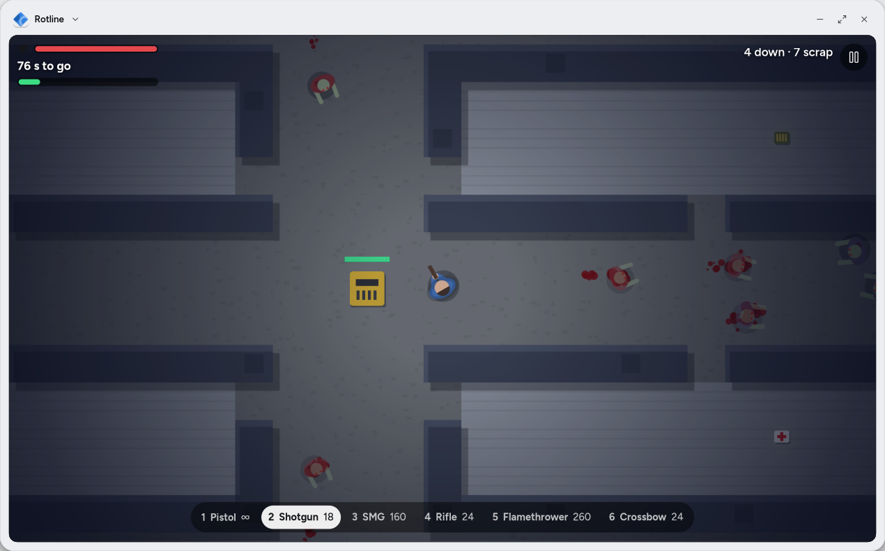
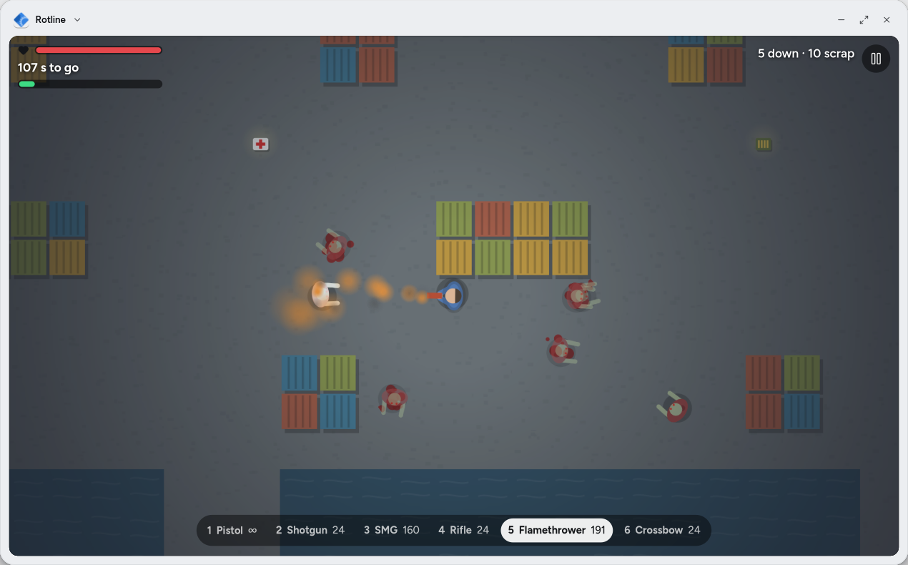
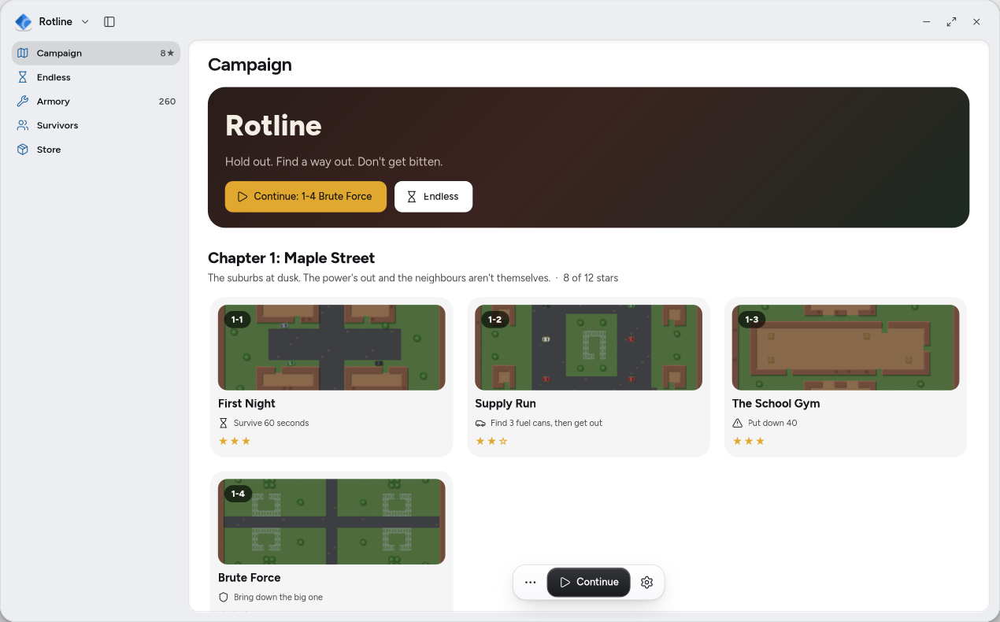
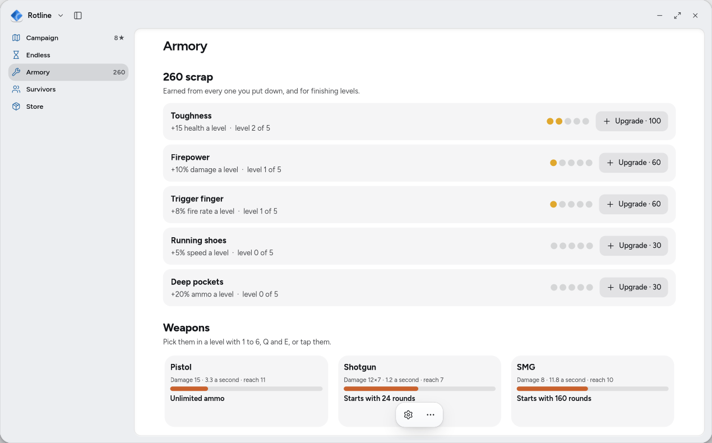
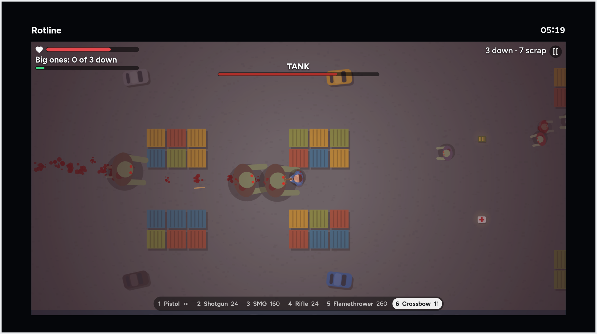

<p align="center">
  
</p>

<p align="center">
  <a href="https://github.com/chartmann1590/rotline/actions/workflows/tests.yml"></a>
  <a href="LICENSE"></a>
  <a href="https://simplyluma.com"></a>
  
</p>

# Rotline

**Top-down zombie survival, made for [Luma](https://simplyluma.com).** The power's out, the neighbours aren't
themselves, and the only way is through. Hold out until morning, find fuel for the car, keep a generator running,
clear the subway and bring down the big ones, across three chapters. Then see how long you last in Endless.

It plays with a keyboard and mouse, a touch screen, a TV remote or a gamepad. Without a mouse, it aims and fires for
you, so a remote or one thumb is enough.

<table>
  <tr>
    <td width="50%"></td>
    <td width="50%"></td>
  </tr>
  <tr>
    <td width="50%"></td>
    <td width="50%"></td>
  </tr>
</table>

### On every Luma device

<table>
  <tr>
    <th>TV, with a remote or a gamepad</th><th>Phone</th>
  </tr>
  <tr>
    <td width="70%"></td>
    <td width="30%" align="center"></td>
  </tr>
</table>

## The game

- **Twelve levels in three chapters.**
  - *Maple Street*: the suburbs at dusk.
  - *Downtown*: night, gridlock, a hospital, the subway and a rooftop.
  - *The Harbor*: fog, warehouses, a lighthouse and the last ferry.
- **Five kinds of goal.**
  - Survive until the timer runs out.
  - Escape: find the fuel cans, then reach the way out.
  - Defend the generator.
  - Clear a horde.
  - Bring down the Tank.
- **Six kinds of dead.**
  - Walkers shuffle and runners don't.
  - Brutes soak up bullets.
  - Spitters keep their distance and spit acid.
  - Bloaters burst, and take their friends with them.
  - The Tank winds up and charges, so step aside.
- **Six weapons.** Each has its own feel.
  - The pistol never runs dry.
  - The shotgun, SMG and rifle are found as you go. The rifle goes through a crowd.
  - The Arsenal pack adds the flamethrower and the crossbow.
- **Endless.** No way out and no end. They come faster and tougher, and something big turns up every couple of
  minutes. Your longest run is kept.
- **The Armory.** Spend scrap on toughness, firepower, fire rate, speed and ammo.
  - You earn scrap from every one you put down, and for finishing levels. You keep it even when you lose.
  - You can give it all back and spend it differently.
- **Stars.** Three for finishing with most of your health, two for half, one for getting out at all.
- **Story mode** halves the damage you take, for anyone who'd rather see the story than fight it.
- **Five survivors** to play as. It's only looks: nobody is stronger.
- No account, no ads, no tracking ([privacy policy](PRIVACY.md)). Playing works offline.

## Controls

| | Move | Aim and fire | Switch weapon | Pause |
| --- | --- | --- | --- | --- |
| **Keyboard and mouse** | <kbd>W</kbd><kbd>A</kbd><kbd>S</kbd><kbd>D</kbd> or arrows | Mouse; hold the left button | <kbd>1</kbd>–<kbd>6</kbd>, <kbd>Q</kbd>/<kbd>E</kbd>, wheel, right-click | <kbd>Esc</kbd> or <kbd>P</kbd> |
| **Keyboard only** | <kbd>W</kbd><kbd>A</kbd><kbd>S</kbd><kbd>D</kbd> or arrows | Automatic (or hold <kbd>Space</kbd>) | <kbd>Return</kbd>, <kbd>Tab</kbd> | <kbd>Esc</kbd> |
| **Touch** | Drag on the left side | Automatic | Tap the right side, or the weapon bar | The pause button |
| **TV remote or gamepad** | Arrows, D-pad or left stick | Automatic | OK (A) | Back (B) |

Without a mouse, Rotline aims at the nearest one it can see and fires when it's in range. You can turn the firing off
in Settings and use <kbd>Space</kbd>. <kbd>F11</kbd> toggles full screen.

## Free, and what's in the store

**Chapter 1, Endless, every upgrade and four of the six weapons are free, with no ads.** The store sells one-time
unlocks that are yours to keep, paid through Stripe in your browser:

| | What you get |
| --- | --- |
| **Chapter 2: Downtown** | Four night levels in the city |
| **Chapter 3: The Harbor** | Four levels in the fog, and the ending |
| **Arsenal** | The flamethrower and the crossbow, in every level and in Endless |
| **Survivors** | Rosa, Hank, Jules and Mo to play as |
| **Complete pack** | All four, for less than buying each |

Prices are shown in the app and come from the store, never from the code. There are no coins, no gems, no timers to
skip, no random rewards and nothing that runs out. Scrap for upgrades is only ever earned by playing.

Purchases are tied to the email on your receipt. Use **Restore purchases** to bring them to another device.

**Why no ads?** Google AdMob, like other ad networks for apps, only runs on Android and iOS. Luma's store rules
(2.3) don't allow advertising identifiers in any app either.

### Updates

The app watches its [GitHub releases](https://github.com/chartmann1590/rotline/releases) and tells you when a new
version is out, with the release notes.

- **Copies installed from Depot** update through Depot, Luma's own updater.
- **Copies from a GitHub download** fetch the bundle for this device and check it against the release's
  `SHA256SUMS`. They then open it in the system installer, which asks you to confirm.

The app never installs anything itself.

## Install

Rotline is headed for **Depot**, Luma's app store. Until it's listed, download the bundle for your device from the
[latest release](https://github.com/chartmann1590/rotline/releases/latest): `x86_64` for computers and TVs,
`aarch64` for phones and tablets. Or build it yourself.

## Build

You need the Luma SDK on `x86_64` or `aarch64` (on Luma, or any Linux with Flatpak):

```sh
flatpak remote-add --if-not-exists luma https://dl.simplyluma.com/luma.flatpakrepo
flatpak install luma org.projectluma.Platform//44 org.projectluma.Sdk//44
flatpak-builder --user --install --install-deps-from=luma build-dir flatpak/com.charleshartmann.Rotline.json
flatpak run com.charleshartmann.Rotline
```

## Tests

```sh
python3 -m pytest tests/test_game.py tests/test_billing.py tests/test_promo.py tests/test_updates.py
xvfb-run flatpak run --command=python3 org.projectluma.Sdk//44 tests/test_ui.py   # the real game, in the Luma runtime
luma lint && luma test                                                            # Luma's app checks
```

`test_game.py` includes a simple bot that has to win every free level without upgrades, so Chapter 1 stays fair.

## Project layout

```
src/rotline/
  game.py      the world: survivor, the dead, shots, pickups and goals (no GTK, unit tested)
  levels.py    the twelve maps, Endless, and what each level asks (no GTK)
  progress.py  stars, scrap, upgrades, survivors and settings (no GTK)
  catalog.py   what the store sells and who owns what (no GTK)
  render.py    the arena: textures painted once with cairo, placed each frame with GtkSnapshot
  sound.py     every effect synthesised in code, mixed into one GStreamer stream
  shop.py      the purchase panel (Stripe Checkout through the license server)
  app.py       the window, the pages, the HUD and the controls
data/          desktop file, AppStream metainfo, icon, TV tile
flatpak/       Flatpak manifests (Depot, and GitHub builds in flatpak/github)
```

## Contributing

Bug reports and ideas are welcome: [open an issue](https://github.com/chartmann1590/rotline/issues/new/choose).
See [CONTRIBUTING.md](CONTRIBUTING.md) before sending a pull request.

## Licence

[GPL-3.0-or-later](LICENSE). Copyright © 2026 Hartmann Studios. The art and the sounds are made in code, for Rotline.
